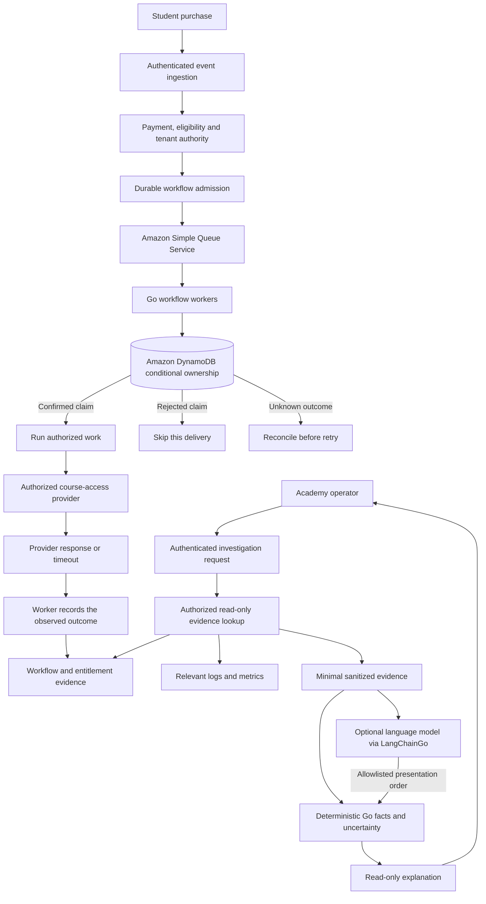
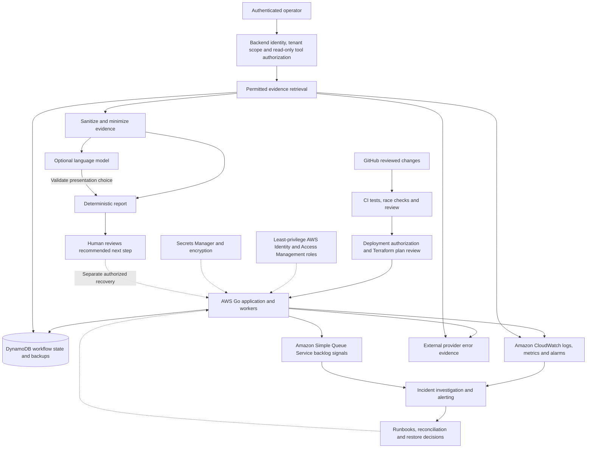

# Reliable Academy Workflows

**Go workflow execution, distributed ownership, and read-only exception investigation with artificial intelligence (AI)**

Reliable Academy Workflows is a backend engineering project for processing academy operations without losing track of who owns a workflow or what has actually happened. Student enrollment and course-access provisioning provide the business case. The workflow engine itself is designed to support reusable business processes.

The project demonstrates stateful workflow execution in Go, atomic claim coordination through DynamoDB, and a read-only investigator that uses LangChainGo with sanitized evidence.

> **Engineering evidence:** Local tests exercise the workflow engine. Independent processes compete for claims against LocalStack Community on loopback. The investigator uses a synthetic fixture and a controlled fake model.

## Business context

An academy wants to automate routine enrollment and course-access workflows while reducing manual work and operational mistakes. A successful payment may create work for multiple backend workers. Only one should acquire ownership of a given execution. If a downstream provider times out, staff need to know whether the original request took effect before they decide to retry.

The original business case targets 10,000 automated tasks per month, 2,500 avoided manual errors per year, and about $200,000 in annual savings. These are unverified targets. A savings estimate would need a measured baseline and operating costs.

## Implemented engineering

### 1. Reusable Go workflow engine

- The accepted milestone 3 and 4 (M3/M4) suites exercise workflow definitions, triggers, branching, actions, wait helpers, and lifecycle behavior. The action runner hands off condition and wait steps. Durable resumption remains production work.
- `WorkflowExecution` tracks status, owner, version, attempt count, error information and transition history.
- `InMemoryWorkflowRepository` uses synchronized access, defensive snapshots, owner checks and version-aware terminal transitions.
- The Gin Hypertext Transfer Protocol (HTTP) application serves `GET /health`. Invocation and status handlers are exercised through local fixtures. Authenticated workflow endpoints remain production work.

The in-memory execution repository is process-local.

### 2. DynamoDB conditional workflow ownership

`internal/dynamodbclaim/claim.go` contains an isolated, loopback-only adapter using the Amazon Web Services (AWS) Software Development Kit (SDK) for Go v2. A single DynamoDB `UpdateItem` requires the workflow item to exist with `status=READY` and `version=1`, then atomically sets `RUNNING`, records an owner and attempt ID, and increments version and attempts.

The caller uses the outcome to decide whether it can proceed.

| Outcome | Meaning | Safe caller decision |
| --- | --- | --- |
| `CLAIMED` | A successful response confirms the transition and matching owner/attempt | May proceed within the bounded simulated-work scope |
| `NOT_CLAIMED` | DynamoDB explicitly rejected the conditional update | Do not execute this work |
| `ERROR/UNKNOWN` | Infrastructure failure or uncertain write outcome | Withhold work and reconcile authoritative state |

`internal/dynamodbclaim/claim_test.go` tests accepted, duplicate, stale-version, missing-record, missing-table and dropped-response cases. The LocalStack experiment launches **ten separate worker processes** against one `READY` item. Exactly one wins and nine receive confirmed rejections. A strongly consistent read verifies `RUNNING`, version 2, attempts 1, and the winner's owner and attempt identifiers. Only the winner creates a **test fixture work marker**. Day 4 reproduced the result once in the standard suite and four times with the race detector.

The fixed version-1 claim is an isolated experiment. Runner integration, durable lease takeover, and guarantees for external enrollment effects remain production work.

### 3. LangChainGo workflow exception investigator

`internal/investigator/evidence.go` and `internal/investigator/investigator.go` implement a **read-only synthetic investigation**. The fixture represents a course-access provider timeout after one attempt. The recorded workflow status is `FAILED`, but the provider may already have applied the request, so the student's current entitlement remains **unknown**.

- `FixtureScope` uses two identifiers to select one predefined synthetic academy and workflow.
- `sanitizedEvidence` copies only permitted status, attempts, transition and provider outcome fields. Student names, contact information and raw error diagnostics do not enter the model request.
- LangChainGo `v0.1.15` provides the prompt template and model interface. The model can select one of two presentation orders, `workflow_first` or `provider_first`.
- A deterministic Go function owns the factual summary, uncertainty and recommended next step. Invalid model output, model errors and deadline expiry use that explanation as fallback.
- The call is bounded to a two-second context deadline, one candidate and 16 requested tokens. The validator limits the returned text to 64 bytes and rejects tool calls. Cancellation depends on the model adapter honoring context cancellation.
- `internal/investigator/investigator_test.go` covers provider timeout, missing evidence or scope, malicious strings in evidence, model failure, output rejection, deadline handling and fixture immutability.

> The workflow recorded `FAILED` after one attempt. The course-access provider request timed out and may have taken effect, so current access is unconfirmed. Check the entitlement and provider request logs using read-only lookups before considering a retry.

The test log records `real_model_invoked=false`. The fake tests exercise the deterministic boundaries around the model. Live-model quality, production identity integration, and operational log retrieval remain unverified.

## Architecture A — Business processing and investigation

**Production target.** The diagram shows proposed connections and controls.



The planned backend determines authorization and controls consequential state transitions. The model can suggest presentation order.

## Architecture B — Security, observability and recovery

**Production target.** Continuous integration (CI), infrastructure provisioning, and cloud operations are planned.



The backend would authenticate operators, check tenant scope, and enforce read-only evidence retrieval before calling a model. Treat retrieved text as untrusted. Reconcile external effects against provider records, and require separate authorization for recovery.

## Reproduce local verification

Use Go `1.24.5`, Python 3, and Git for the standard checks. The opt-in tests require LocalStack Community with DynamoDB running at `127.0.0.1:4566`. Day 4 used LocalStack `4.14.0` on Docker. The test adapter pins the loopback endpoint and uses fixture credentials.

```bash
# Repository-wide source and regression checks
bash scripts/verify.sh

# Focused read-only investigation tests (fake model)
go test -count=1 -v ./internal/investigator

# Opt-in loopback LocalStack claim and independent-process tests
curl --noproxy '*' --fail --silent --show-error http://127.0.0.1:4566/_localstack/health
P1_DYNAMODB_CLAIM_TEST=1 go test -count=1 -v ./internal/dynamodbclaim -run '^TestLocal(ConditionalClaim|ClaimProcesses)$'

# Race-detector run for claim integration
P1_DYNAMODB_CLAIM_TEST=1 go test -race -count=4 -v ./internal/dynamodbclaim -run '^TestLocalClaimProcesses$'
```

The canonical verifier checks the tracker, Python harness, Go unit tests, race detector, `go vet`, and Git whitespace. Run the opt-in LocalStack commands separately for cross-process evidence. Day 4 recorded five investigator tests and eight subtests, one standard ten-process contention run, and four race repeats. Every contention run produced one confirmed winner, nine confirmed rejections, and one fixture work marker. See [the handoff](docs/HANDOFF.md) for exact commands, process IDs, and cleanup evidence.

## Engineering status and limitations

| Area | Status | Evidence or boundary |
| --- | --- | --- |
| Go workflow state, ownership and local test suite | **IMPLEMENTED / locally VERIFIED** | Go source, accepted M3/M4 regression history |
| DynamoDB claim adapter | **IMPLEMENTED / EMULATED / locally VERIFIED** | Loopback LocalStack conditional-write and ten-process tests |
| AI exception investigator | **IMPLEMENTED / locally VERIFIED with fake model** | LangChainGo prompt and model interface, synthetic fixture, negative tests |
| Production AWS ingestion, queue workers and enrollment integration | **DESIGNED / DEFERRED** | Architecture diagrams only |
| Production operator authentication and tenant-authorized evidence tools | **DESIGNED / DEFERRED** | Current scope selects a synthetic fixture |
| Live model quality, costs, latency and grounding | **NOT VERIFIED / DEFERRED** | `real_model_invoked=false` |
| Distributed recovery, exactly-once external business effects and measured savings | **DEFERRED** | Requires production design and validation |
| Production infrastructure, deployment and operational service-level measurements | **DESIGNED / DEFERRED** | Production-target diagrams only |

## Engineering decisions

- **Why Go?** Clear state transitions, concurrency primitives, explicit interfaces and focused test coverage for backend workflow correctness.
- **Why DynamoDB conditional updates?** The database arbitrates ownership across processes. A local mutex coordinates workers within one process.
- **Why distinguish unknown from rejected?** A response can be lost after a successful write. Unknown outcomes cannot authorize another external business effect.
- **Why LangChainGo?** The experiment uses a model only for presentation. Deterministic Go owns the facts, uncertainty, and recommended next step. A plain Go response covers the same fixed diagnostics.
- **Why read-only AI?** The investigator has no mutation path. The backend owns business actions.

## Further production work

Connect durable workflow admission to worker lifecycle management and authorized provider integration. Add tenant-aware authentication, read-only operational evidence access, monitoring, alerting, and recovery. Validate behavior under load and AWS failure conditions. Measure live-model performance and cost through approved, bounded tests.

For the accepted milestone scope and history, see [the feature tracker](feature_list.json), [progress log](PROGRESS.md), and [roadmap](docs/ROADMAP.md).
